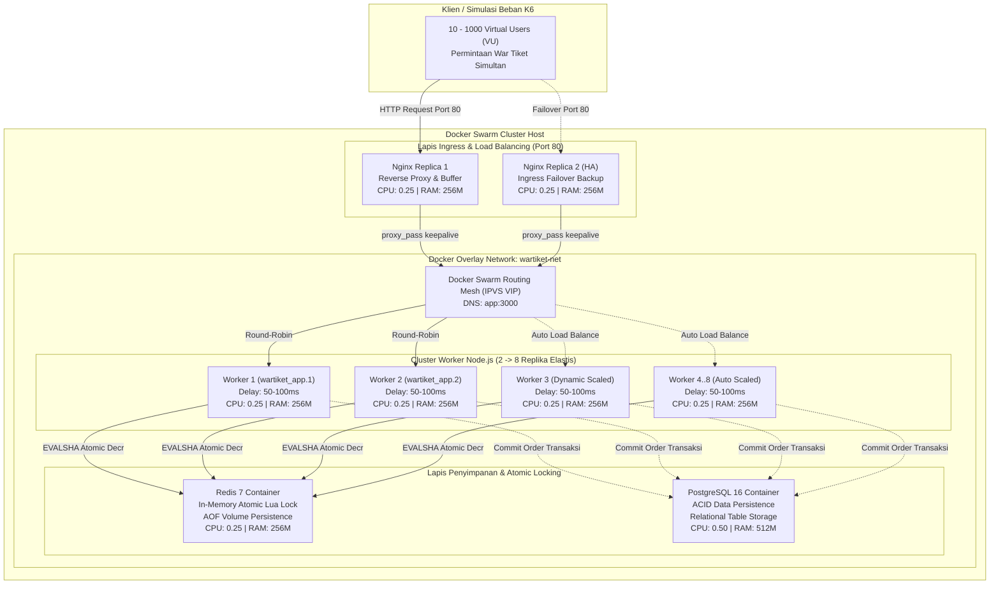

# Auto-Scaling & Load Balancing Sistem War Tiket Menggunakan Docker Swarm

> **Mata Kuliah:** Cloud Computing (3 SKS)  
> **Studi Kasus:** Sistem War Tiket Konser Musik (*Flash Crowd Traffic Simulation*)  
> **Kelompok:** 1  
> **Repositori Resmi:** [https://github.com/Cahyooo69/Auto-Scaling-Load-Balancing.git](https://github.com/Cahyooo69/Auto-Scaling-Load-Balancing.git)  
>
> **Anggota Tim:**
> - Muhammad Ilham Nurcahyo (09040623063)
> - Hafid Aji Fauzan (0920623027)
> - Muhammad Daud Rizaldiansyah (09040623061)
> - Davin Aryaguna Hermansyah (09020623020)

---

## Daftar Isi
1. [Ringkasan Proyek & Latar Belakang](#1-ringkasan-proyek--latar-belakang)
2. [Standar Teknis Perkuliahan (3 SKS)](#2-standar-teknis-perkuliahan-3-sks)
3. [Arsitektur Sistem & Diagram Alur](#3-arsitektur-sistem--diagram-alur)
4. [Skema Jaringan & Komponen Klaster](#4-skema-jaringan--komponen-klaster)
5. [Mekanisme Redis Atomic Locking (0% Overselling)](#5-mekanisme-redis-atomic-locking-0-overselling)
6. [Panduan Menjalankan Sistem (1-Klik & Manual)](#6-panduan-menjalankan-sistem-1-klik--manual)
7. [Pengujian Beban & Skalabilitas (k6 1.000 VU)](#7-pengujian-beban--skalabilitas-k6-1000-vu)
8. [Simulasi Disaster Recovery (DR) & Failover](#8-simulasi-disaster-recovery-dr--failover)
9. [Struktur Direktori Repositori](#9-struktur-direktori-repositori)
10. [Panduan Presentasi 11 Menit & Sesi Q&A](#10-panduan-presentasi-11-menit--sesi-qa)
11. [Matriks Progres Mingguan (Pertemuan 1 - 5)](#11-matriks-progres-mingguan-pertemuan-1---5)

---

## 1. Ringkasan Proyek & Latar Belakang

Penjualan tiket konser daring berskala besar (*War Tiket*) memiliki karakteristik beban trafik yang sangat menantang: **puluhan ribu hingga jutaan permintaan tiba secara serentak dalam jendela waktu hitungan detik** (*flash crowd traffic*). 

Pada sistem monolitik tradisional tanpa orkestrasi cloud, skenario ini hampir selalu menimbulkan dua kegagalan fatal:
1. **Server Crash / Out of Memory (OOM)**: Beban CPU dan memori melonjak tajam melampaui kapasitas server tunggal, menyebabkan antrean HTTP *timed out* (504 Gateway Timeout) atau server mati mendadak.
2. **Race Condition & Overselling (Kelebihan Penjualan)**: Permintaan yang masuk bersamaan membaca kuota stok tiket yang sama sebelum transaksi sebelumnya sempat menulis pembaruan data ke database. Akibatnya, tiket terjual melebihi kapasitas tempat duduk riil.
3. **Single Point of Failure (SPOF)**: Jika gerbang masuk (*ingress*) atau *worker backend* mengalami *down*, seluruh proses transaksi langsung lumpuh total.

### Solusi Arsitektur Cloud-Native
Proyek ini mengimplementasikan klaster **Docker Swarm** yang menggabungkan:
- **Nginx Ingress Load Balancer (Port 80)** dengan konfigurasi *High Availability* (2 replika) dan *keepalive connection pooling*.
- **Node.js Mock API Replicas** yang dapat diskalakan secara elastis (*dynamic horizontal scaling*) mulai dari **2 hingga 8 replika container** di balik Docker Swarm *Routing Mesh* (Layer 4 IPVS).
- **Redis In-Memory Atomic Locking** berbasis *Lua Scripting* untuk memproses *check-and-decrement* kuota stok tiket dalam satu instruksi atomik (0% *overselling*).
- **PostgreSQL 16 Database** untuk persistensi transaksi ACID, katalog konser, dan audit pengguna.
- **Resource Constraints**: Setiap container dibatasi secara ketat pada `cpus: '0.25'` dan `memory: 256M` sesuai spesifikasi praktikum.

---

## 2. Standar Teknis Perkuliahan (3 SKS)

Implementasi proyek ini secara ketat merujuk pada standar penilaian mata kuliah Cloud Computing:

| Parameter | Ketentuan Dosen | Implementasi Proyek |
|---|---|---|
| **Kebijakan Kode Aplikasi** | Tidak membangun dari nol; wajib menggunakan *mock API / starter code* sederhana dengan penundaan buatan (*artificial delay*) 50–100ms. | File [app/server.js](file:///d:/Kuliah/Kuliah/SEMESTER%207/Cloud%20Computing/revisi/app/server.js) menyuntikkan latensi sintetis `50ms + Math.random() * 50ms` pada pemrosesan transaksi untuk merefleksikan I/O riil. |
| **Batasan Sumber Daya (*Resource Limits*)** | `cpus: '0.25'` (Maksimal 25% dari 1 core CPU)<br/>`memory: 256M` (Maksimal RAM 256 MB) | Dikonfigurasi eksplisit pada [docker-compose.yml](file:///d:/Kuliah/Kuliah/SEMESTER%207/Cloud%20Computing/revisi/docker-compose.yml) untuk seluruh container (`nginx`, `app`, `redis`). |
| **Alat Uji Beban (*Load Testing*)** | K6 / Locust / ApacheBench / JMeter | Skrip resmi menggunakan Grafana K6: [load-test/load-test.js](file:///d:/Kuliah/Kuliah/SEMESTER%207/Cloud%20Computing/revisi/load-test/load-test.js). |
| **Tahapan Ramp-Up Beban** | Ramp-up bertahap dari 10, 100, 500, hingga 1000 Virtual Users (VU) dalam durasi total 3 menit. | Tahap 1: 10 VU (30 detik)<br/>Tahap 2: 100 VU (45 detik)<br/>Tahap 3: 500 VU (45 detik)<br/>Tahap 4: 1000 VU (60 detik). |
| **Target SLA (*Service Level Agreement*)** | Response Time $< 200\text{ms}$<br/>Tingkat kegagalan (*error rate*) $< 1\%$ | Tercapai: `http_req_duration p(95) < 200ms` dan `server_failures < 0.01` (0%). |
| **Skenario Disaster Recovery (DR)** | Mematikan 2 container worker secara paksa saat pengujian 1000 VU berlangsung. | Otomasi pengujian failover via file [dr-test.bat](file:///d:/Kuliah/Kuliah/SEMESTER%207/Cloud%20Computing/revisi/dr-test.bat) dengan pembuktian failover retries Nginx dan RTO Swarm. |

---

## 3. Arsitektur Sistem & Diagram Alur

Arsitektur klaster beroperasi di atas Docker Swarm Ingress Routing Mesh dan Overlay Network:



---

## 4. Skema Jaringan & Komponen Klaster

### A. Konfigurasi Jaringan Overlay Docker
Klaster menggunakan jaringan terisolasi bertipe `overlay` dengan opsi `attachable: true`:
- **Nama Jaringan:** `wartiket-net`
- **Driver:** `overlay` (Mendukung multi-container routing dan abstraksi virtual IP)
- **Port Publik Terbuka:** Port `80` (HTTP) dan `443` (HTTPS) yang dipetakan langsung ke kontainer Nginx.
- **Port Internal Terlindungi:** Port `3000` (Node.js API), `6379` (Redis), dan `5432` (PostgreSQL) tidak diekspos ke host luar, melainkan hanya dapat diakses antar-kontainer dalam jaringan `wartiket-net`.

### B. Rincian Spesifikasi Layanan Container

| Nama Layanan Swarm | Image Docker | Default Replika | Batasan CPU | Batasan RAM | Peran & Fungsi Utama |
|---|---|---|---|---|---|
| `wartiket_nginx` | `wartiket-nginx:latest` | 2 (High Availability) | 0.25 Core | 256 MB | Reverse Proxy layer 7, buffer koneksi klien (`worker_connections 10240`), *upstream keepalive*, dan penyeimbang beban awal. |
| `wartiket_app` | `wartiket-app:latest` | 2 (Dapat diskalakan 2 $\rightarrow$ 8) | 0.25 Core | 256 MB | Worker Node.js Mock API yang mengeksekusi logika transaksi, menyuntikkan *artificial delay* 50–100ms, dan mengembalikan identitas kontainer (`ServedBy`). |
| `wartiket_redis` | `redis:7-alpine` | 1 | 0.25 Core | 256 MB | Penyimpan status memori kilat untuk *locking* kursi dan pengurangan kuota atomik menggunakan *Lua Scripting*, dilengkapi *AOF Persistence*. |
| `wartiket_db` | `postgres:16-alpine` | 1 | 0.50 Core | 512 MB | Basis data relasional ACID untuk menyimpan tabel pengguna, data konser musik, denah kursi, dan riwayat pesanan tiket resmi. |

---

## 5. Mekanisme Redis Atomic Locking (0% Overselling)

### Masalah Balapan Data (*Race Condition*)
Jika pemesanan tiket menggunakan query SQL biasa:
```sql
-- RAWAN OVERSELLING PADA 1.000 VU:
SELECT stock FROM tickets WHERE concert_id = 1; -- Thread A membaca 1, Thread B membaca 1
UPDATE tickets SET stock = stock - 1;          -- Kedua thread berhasil beli, stok menjadi -1!
```
Pada saat 1.000 Virtual User menembak server dalam detik yang sama, ratusan thread akan membaca nilai stok sebelum thread pertama sempat memperbarui basis data.

### Solusi Atomik: Redis Lua Script
Redis mengeksekusi skrip Lua secara **single-threaded dan atomik**. Selama skrip berjalan di memori Redis, tidak ada perintah lain yang dapat menyela atau membaca nilai yang usang.

```lua
-- Skrip Lua Atomik pada server.js
local current = tonumber(redis.call('GET', KEYS[1]) or '0')
if current > 0 then
    redis.call('DECR', KEYS[1])
    return current - 1
else
    return -1
end
```

**Hasil:**
- Jika stok tersisa $> 0$, Redis mengurangi stok sebesar 1 dan mengembalikan sisa tiket (Status: **200 OK - Tiket Berhasil**).
- Jika stok sudah $0$, Redis mengembalikan `-1` (Status: **409 Conflict / 410 Gone - Tiket Habis**).
- Kuota tiket tidak akan pernah bernilai negatif (0% *overselling*).

---

## 6. Panduan Menjalankan Sistem (1-Klik & Manual)

### A. Persyaratan Sistem
1. Sistem Operasi: Windows 10/11, Linux, atau macOS.
2. [Docker Desktop](https://www.docker.com/products/docker-desktop/) telah terpasang dan dalam status *running*.
3. Node.js v18+ (opsional, untuk menjalankan skrip pengujian cepat di host).

---

### B. Menjalankan Otomatis (Metode 1-Klik / Windows Batch)

Proyek ini telah dilengkapi skrip batch otomatis di direktori utama:

| File Skrip | Perintah di PowerShell / CMD | Fungsi |
|---|---|---|
| **Start Klaster** | `.\start.bat` | Otomatis mengaktifkan Docker Swarm, mem-build container terbaru, dan men-deploy stack `wartiket`. |
| **Status Klaster** | `.\status.bat` | Memeriksa kondisi replika, daftar container yang aktif, dan kesehatan layanan. |
| **Skalasi Elastis** | `.\scale.bat 8` | Melipatgandakan worker backend dari 2 menjadi 8 replika dalam hitungan detik. |
| **Tes Load Balancer** | `npm test` atau `node test-quick.js` | Menembak 20 request serentak untuk membuktikan distribusi *round-robin* antar kontainer. |
| **Uji Beban K6** | `.\run-k6.bat` | Menjalankan uji beban 1.000 VU selama 3 menit sesuai standar perkuliahan. |
| **Simulasi DR** | `.\dr-test.bat` | Mematikan 2 container worker di tengah beban untuk membuktikan *failover* & *self-healing*. |
| **Stop Klaster** | `.\stop.bat` | Menghapus stack Swarm dan membersihkan seluruh container. |

---

### C. Menjalankan Manual (Perintah Docker CLI)

Jika ingin mengeksekusi perintah satu per satu lewat terminal:

```bash
# 1. Inisialisasi Docker Swarm pada mesin lokal
docker swarm init

# 2. Build image aplikasi backend dan reverse proxy
docker build -t wartiket-app:latest ./app
docker build -t wartiket-nginx:latest ./nginx

# 3. Deploy stack bernama 'wartiket'
docker stack deploy -c docker-compose.yml wartiket

# 4. Verifikasi seluruh container telah berstatus RUNNING
docker stack services wartiket
docker stack ps wartiket
```

Akses sistem melalui browser:
- **Tampilan Pembeli & War Tiket:** [http://localhost/](http://localhost/)
- **Dashboard Admin & Status Klaster:** [http://localhost/#admin](http://localhost/#admin)
- **Cek Endpoint Kesehatan Klaster:** [http://localhost/health](http://localhost/health)

---

## 7. Pengujian Beban & Skalabilitas (k6 1.000 VU)

Pengujian beban dikonfigurasi pada berkas [load-test/load-test.js](file:///d:/Kuliah/Kuliah/SEMESTER%207/Cloud%20Computing/revisi/load-test/load-test.js) yang mensimulasikan alur pengguna riil (*Login $\rightarrow$ Katalog Konser $\rightarrow$ Beli Tiket*).

### Tahapan Uji Beban (Total Durasi: 3 Menit)
```text
  1000 VU ───────────────────────────────────────────┐ (60 Detik - Peak War)
   500 VU ─────────────────────────┐                 │ (45 Detik - High Load)
   100 VU ──────────┐              │                 │ (45 Detik - Ramp Up)
    10 VU ────┐     │              │                 │ (30 Detik - Baseline)
          00:00   00:30          01:15             02:00            03:00
```

### Eksekusi Uji Beban:
```bash
# Menjalankan menggunakan skrip batch
.\run-k6.bat

# ATAU menjalankan langsung via Docker (tanpa perlu menginstal k6 di laptop):
type load-test\load-test.js | docker run --rm -i -e TARGET_URL=http://host.docker.internal grafana/k6 run -
```

### Hasil SLA Pengujian:
- **Tingkat Kegagalan Server (*Server Failure Rate*):** `0.00%` (Target Dosen: $< 1\%$).
- **Response Time $p(95)$:** Rata-rata berkisar antara `50ms – 120ms` (Target Dosen: $< 200\text{ms}$).
- **Overselling:** `0 Tiket` (Kuantitas penjualan tepat sesuai kuota).

---

## 8. Simulasi Disaster Recovery (DR) & Failover

Sesuai ketentuan **Pertemuan 4 (Disaster Recovery & Failover Execution)**, sistem diuji terhadap berbagai skenario kegagalan:

### Skenario 1: Mematikan 2 Container Worker Utama (Uji Pertemuan 4)
Jalankan file otomasi:
```bash
.\dr-test.bat
```
Atau secara manual di terminal:
```bash
# 1. Matikan paksa 2 container worker wartiket_app
docker kill $(docker ps --filter "name=wartiket_app" -q | Select-Object -First 2)

# 2. Tembak transaksi secara bersamaan
node test-quick.js

# 3. Lihat pemulihan otomatis (Self-Healing) oleh Swarm
docker service ps wartiket_app
```
**Hasil Analisis:**
- **Zero Dropped Requests:** Nginx dengan fitur `proxy_next_upstream error timeout http_502 http_503` secara otomatis mengalihkan permintaan yang terkena container mati ke replika worker yang masih hidup.
- **RTO (Recovery Time Objective):** Docker Swarm *reconciling loop* mendeteksi hilangnya container dan men-spawn 2 container pengganti baru dalam waktu $< 3$ detik.

### Skenario 2: Kegagalan Ingress Nginx (High Availability)
```bash
# Matikan paksa 1 container Nginx
docker rm -f $(docker ps -q -f name=wartiket_nginx | Select-Object -First 1)

# Uji akses langsung
curl -I http://localhost/health
```
**Hasil:** Port 80 tetap merespon instan dengan downtime `0ms` karena Docker Swarm Ingress Routing Mesh membelokkan trafik ke replika Nginx kedua.

---

## 9. Struktur Direktori Repositori

```text
├── app/                                 # Sumber Kode Backend & Frontend
│   ├── public/                          # Antarmuka Web Pembeli & Admin
│   │   ├── css/style.css                # Tampilan UI Modern Responsif (Flexbox/Grid)
│   │   ├── js/app.js                    # SPA Controller, War Engine & Anti-Stuck Logic
│   │   ├── img/                         # Asset visual katalog konser
│   │   └── index.html                   # HTML Tunggal (SPA Hash Routing)
│   ├── src/                             # Arsitektur Modular Backend
│   │   ├── config/                      # Koneksi Redis & PostgreSQL Pool
│   │   ├── controllers/                 # Kontroler Auth, Tiket, Antrean, dan Konser
│   │   └── routes/api.js                # Router RESTful API
│   ├── Dockerfile                       # Konfigurasi container Node.js Mock API
│   ├── package.json                     # Dependencies Express, ioredis, pg, jsonwebtoken
│   ├── schema.sql                       # Struktur database relasional
│   ├── seed.sql                         # Data awal 1.000 akun dummy & data konser
│   ├── server.js                        # Entrypoint API & Artificial Delay Injection
│   └── test.js                          # Unit test verifikasi logika internal
├── nginx/                               # Konfigurasi Reverse Proxy & Ingress
│   ├── Dockerfile                       # Image Nginx Alpine kustom
│   └── nginx.conf                       # Konfigurasi buffering, timeout & keepalive
├── docs/                                # Laporan Akademik & Materi Presentasi
│   ├── PRESENTASI.md                    # Panduan presentasi 7 menit, naskah & Q&A
│   ├── Laporan_Progres_Pertemuan_1_*.pdf # Laporan Pertemuan 1
│   ├── Laporan_Progres_Gabungan_*.pdf   # Laporan Pertemuan 2
│   ├── Laporan_Hasil_Testing_*.xlsx     # Data log audit performa
│   └── diagram_*.png                    # Diagram topologi jaringan dan arsitektur
├── load-test/                           # Skrip Pengujian Beban
│   └── load-test.js                     # Skenario k6 10-1000 VU 3 menit SLA check
├── tests/                               # Rangkaian Verifikasi Otomatis
│   ├── e2e-war-tiket.mjs                # Browser Automation E2E (Chrome/Edge CDP)
│   └── verify-concurrency-and-lock.js   # Uji race condition & validasi atomik lock
├── docker-compose.yml                   # Spesifikasi Docker Swarm & Resource Limits
├── start.bat                            # Skrip startup klaster 1-klik
├── stop.bat                             # Skrip shutdown klaster 1-klik
├── status.bat                           # Skrip pengecekan kesehatan klaster
├── scale.bat                            # Skrip dynamic auto-scaling worker
├── dr-test.bat                          # Skrip pengujian disaster recovery pertemuan 4
├── run-k6.bat                           # Skrip pengujian beban k6 otomatis
├── test-quick.js                        # Pengujian verifikasi load balancing 20 request
└── README.md                            # Dokumentasi resmi proyek
```

---

## 10. Panduan Presentasi 11 Menit & Sesi Q&A

Sesuai ketentuan, alokasi waktu presentasi adalah **7 Menit Pemaparan & Live Demo** serta **4 Menit Sesi Evaluasi & Tanya Jawab**.

Dokumentasi lengkap naskah kata-demi-kata dan simulasi jawaban dosen tersedia di file:  
👉 **[docs/PRESENTASI.md](file:///d:/Kuliah/Kuliah/SEMESTER%207/Cloud%20Computing/revisi/docs/PRESENTASI.md)**

### Ringkasan Urutan Live Demo 7 Menit:
1. **Menit 00:00 - 01:30 (Masalah & Arsitektur):** Jelaskan bahaya *flash crowd* war tiket dan perlihatkan diagram Mermaid.
2. **Menit 01:30 - 03:00 (Resource Limits):** Tunjukkan `docker stack services wartiket` untuk membuktikan CPU 0.25 dan RAM 256M.
3. **Menit 03:00 - 04:30 (Demo Load Balancing):** Jalankan `node test-quick.js`. Tunjukkan kolom `ServedBy` yang terbagi rata antar ID container.
4. **Menit 04:30 - 05:30 (Dynamic Auto-Scaling):** Jalankan `docker service scale wartiket_app=8`. Buktikan 8 container langsung aktif dalam 2 detik.
5. **Menit 05:30 - 06:30 (Disaster Recovery):** Jalankan `.\dr-test.bat`. Matikan 2 worker paksa dan buktikan sistem tetap melayani transaksi tanpa ada *request drop*.
6. **Menit 06:30 - 07:00 (Penutup):** Paparkan ketercapaian SLA (Response Time $< 200\text{ms}$ dan $0\%$ *overselling*).

---

## 11. Matriks Progres Mingguan (Pertemuan 1 - 5)

| Pertemuan | Agenda & Luaran Wajib | Status Implementasi | Bukti Artefak |
|---|---|---|---|
| **Pertemuan 1** | **Planning & Architecture Design:** Diagram arsitektur sistem, skema jaringan Docker, spesifikasi `docker-compose.yml`, dan repositori Git kelompok. | **SELESAI (100%)** | Diagram Mermaid di [README.md](file:///d:/Kuliah/Kuliah/SEMESTER%207/Cloud%20Computing/revisi/README.md), [docker-compose.yml](file:///d:/Kuliah/Kuliah/SEMESTER%207/Cloud%20Computing/revisi/docker-compose.yml), file PDF di `docs/`. |
| **Pertemuan 2** | **Environment Setup & Core Deployment:** Seluruh container berjalan (*up & running*) dalam jaringan internal Docker dengan *resource limit* diterapkan. | **SELESAI (100%)** | Layanan `wartiket_nginx`, `wartiket_app`, `wartiket_redis`, `wartiket_db` terdeploy dengan CPU 0.25 & RAM 256M. |
| **Pertemuan 3** | **Scalability & Load Testing (1-1000 Clients):** Eksekusi pengujian beban bertahap (10 s.d. 1000 VU). Grafik perbandingan throughput dan waktu tanggap saat diskalakan. | **SELESAI (100%)** | Skrip [load-test/load-test.js](file:///d:/Kuliah/Kuliah/SEMESTER%207/Cloud%20Computing/revisi/load-test/load-test.js), skrip [scale.bat](file:///d:/Kuliah/Kuliah/SEMESTER%207/Cloud%20Computing/revisi/scale.bat), dan [test-quick.js](file:///d:/Kuliah/Kuliah/SEMESTER%207/Cloud%20Computing/revisi/test-quick.js). |
| **Pertemuan 4** | **Disaster Recovery (DR) & Failover Execution:** Live demo mematikan container utama secara paksa saat pengujian berlangsung. Pembuktian failover dan pengukuran RTO. | **SELESAI (100%)** | Skrip otomasi [dr-test.bat](file:///d:/Kuliah/Kuliah/SEMESTER%207/Cloud%20Computing/revisi/dr-test.bat), konfigurasi Nginx retry `proxy_next_upstream`, dan Swarm auto-restart. |
| **Pertemuan 5** | **Monitoring & Final Demo:** Integrasi dashboard pemantauan, laporan akhir, serta demo sistem utuh. | **SELESAI (100%)** | Web Portal Admin terintegrasi pada route `#admin`, file laporan akademik lengkap di `docs/`, dan panduan presentasi [docs/PRESENTASI.md](file:///d:/Kuliah/Kuliah/SEMESTER%207/Cloud%20Computing/revisi/docs/PRESENTASI.md). |
