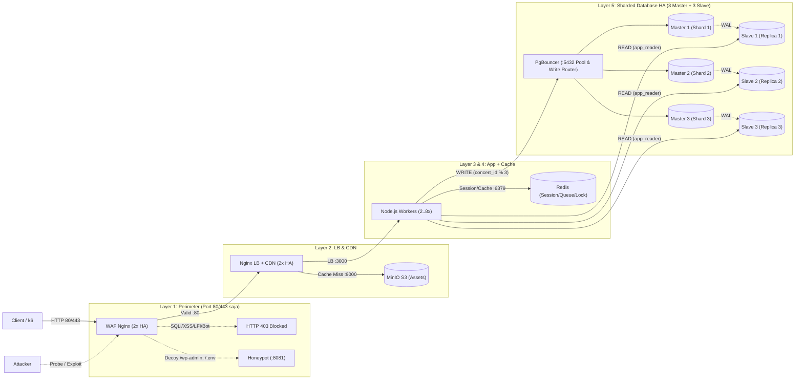

# Auto-Scaling & Load Balancing Sistem War Tiket (Docker Swarm)

Simulasi sistem penjualan tiket konser (*flash crowd traffic*) untuk mata kuliah **Cloud Computing (3 SKS)**, Kelompok 1. Sistem ini berjalan di atas klaster Docker Swarm dengan arsitektur **5-Layer Defense-in-Depth** dan **3 Master + 3 Slave PostgreSQL 16 (Sharded HA)**.

**Tim Pengembang (Kelompok 1)**
- Muhammad Ilham Nurcahyo (09040623063)
- Hafid Aji Fauzan (0920623027)
- Muhammad Daud Rizaldiansyah (09040623061)
- Davin Aryaguna Hermansyah (09020623020)

**Dokumen Terkait:** [Diagram Editable (draw.io)](docs/arsitektur-sistem-wartiket.drawio) | [Matriks Keamanan & Sharding](docs/SECURITY_ACCESS_MATRIX.md) | [Panduan Presentasi & Demo](docs/PRESENTASI.md)

---

## Ringkasan Masalah & Arsitektur

Pada momen war tiket, ribuan permintaan datang bersamaan dalam hitungan detik. Sistem server tunggal rentan mengalami kehabisan memori (OOM), kelebihan penjualan akibat *race condition* (*overselling*), serta lumpuh total ketika satu komponen mati (*single point of failure*).

Proyek ini memecah beban kerja ke dalam 5 lapisan terisolasi di jaringan overlay `wartiket-net`:

1. **Layer 1 (Perimeter Security):** `wartiket_waf` (2 replika HA) adalah satu-satunya layanan yang membuka port publik `80` dan `443`. WAF menyaring pola SQLi, XSS, LFI, scanner bot (`HTTP 403`), dan rate-limit, serta mengalihkan probe ke jalur jebakan (`/wp-admin`, `/.env`, `/phpmyadmin`) menuju `wartiket_honeypot` untuk dicatat ke Prometheus dan Grafana.
2. **Layer 2 (Load Balancer, CDN & Object Storage):** `wartiket_nginx` (2 replika HA) membagi trafik ke worker aplikasi sekaligus menjadi *pull-through CDN edge cache* (`/cdn/*` dan `cdn.wartiketkonser.id`) dengan origin `wartiket_minio` (S3-compatible bucket `wartiket-assets`).
3. **Layer 3 (Stateless App Workers):** `wartiket_app` (elastis 2 hingga 8 replika, batas `0.25 CPU` dan `256 MB` RAM) menangani autentikasi HS256 JWT, proteksi RBAC/IDOR, antrean ruang tunggu, serta *2-Step Checkout* (hold kursi 5 menit `PENDING` lalu konfirmasi `PAID` atau otomatis `EXPIRED`).
4. **Layer 4 (In-Memory Cache & Lock):** `wartiket_redis` khusus menyimpan data non-finansial: sesi login stateless, antrean FIFO, cache katalog/kursi, dan penguncian stok/kursi atomik berbasis skrip Lua.
5. **Layer 5 (Sharded Database HA):** `wartiket_pgbouncer` menyatukan koneksi tulis dari seluruh worker (`transaction pooling`, 30 pool per shard) menuju **3 Shard PostgreSQL 16 Master** (`concert_id % 3`, role `app_writer`). Setiap master mereplikasi data secara *streaming WAL* ke **3 Slave Read Replica** (role `app_reader`, *SELECT-only*) untuk melayani query baca dengan failover otomatis ke master jika replika terganggu.


<details>
<summary>Lihat versi diagram alur Mermaid</summary>



</details>

---

## Spesifikasi Layanan Klaster

Seluruh layanan dikonfigurasi di [docker-compose.yml](docker-compose.yml) dengan batas CPU/RAM eksplisit agar sesuai standar perkuliahan 3 SKS:

| Layanan Swarm | Image | Replika | Batas CPU / RAM | Peran Utama |
|---|---|---|---|---|
| `wartiket_waf` | `wartiket-waf:latest` | 2 (HA) | 0.25 Core / 128 MB | Gerbang publik `80/443`, filter SQLi/XSS/LFI/bot, rate-limit, routing decoy |
| `wartiket_honeypot` | `wartiket-honeypot:latest` | 1 | 0.10 Core / 64 MB | Jebakan `/wp-admin`, `/.env`, `/phpmyadmin` + metrik Prometheus `:8081` |
| `wartiket_nginx` | `wartiket-nginx:latest` | 2 (HA) | 0.25 Core / 256 MB | Internal load balancer + CDN edge cache (`proxy_cache`) |
| `wartiket_minio` | `bitnamilegacy/minio:latest` | 1 | 0.25 Core / 384 MB | Object storage S3 untuk poster, CSS, dan JS (`wartiket-assets`) |
| `wartiket_app` | `wartiket-app:latest` | 2 (skala 2 s.d. 8) | 0.25 Core / 256 MB | Stateless API worker, 2-step checkout, routing 3 shard |
| `wartiket_redis` | `redis:7-alpine` | 1 | 0.25 Core / 256 MB | Session store, antrean waiting room, hot cache, atomic lock |
| `wartiket_pgbouncer` | `edoburu/pgbouncer:latest` | 1 | 0.25 Core / 128 MB | Transaction pooler (maks. 1.000 klien ke `wartiket_shard1..3`) |
| `wartiket_db-shard1..3-primary` | `postgres:16-alpine` | 3 (Master) | 0.35 Core / 384 MB | 3 shard master (`concert_id % 3`, role `app_writer`) + WAL sender |
| `wartiket_db-shard1..3-replica` | `postgres:16-alpine` | 3 (Slave) | 0.25 Core / 256 MB | 3 shard hot standby replica (role `app_reader`, *SELECT-only*) |

**Target SLA Perkuliahan (3 SKS):**
- Batas worker aplikasi: `0.25 CPU` dan `256 MB` RAM per replika.
- Ramp-up beban k6 ([load-test/load-test.js](load-test/load-test.js)): 10 VU (30 dtk) -> 100 VU (45 dtk) -> 500 VU (45 dtk) -> 1.000 VU (60 dtk).
- Ambang performa: `p(95) < 200 ms`, tingkat kegagalan server `< 1%`, dan `0%` *overselling*.
- Skenario Disaster Recovery: mematikan 2 container worker secara paksa di tengah beban tanpa memutus transaksi klien.

---

## Mekanisme Anti-Overselling (Redis Lua & 2-Step Checkout)

Untuk mencegah dua pengguna membeli kursi yang sama secara bersamaan, sistem memadukan penguncian atomik di memori Redis dengan transaksi CTE di PostgreSQL:

1. **Pengurangan Stok Atomik di Redis:** [app/src/config/redis.js](app/src/config/redis.js) mengeksekusi skrip Lua *single-threaded* sehingga pembacaan dan pengurangan stok tidak dapat disela request lain.
2. **2-Step Checkout (TTL 5 Menit):** `POST /api/tickets/reserve` mengunci kursi dengan status `PENDING` (HTTP `201`) selama 300 detik. Pembayaran diselesaikan melalui `POST /api/tickets/confirm` (`PAID`, HTTP `200`).
3. **Auto-Expiry Sweeper:** Jika batas waktu 5 menit habis, sweeper berkala di [app/src/controllers/ticketController.js](app/src/controllers/ticketController.js) menandai pesanan `EXPIRED` (`FOR UPDATE OF b SKIP LOCKED`), melepas kursi kembali ke `Available`, dan mengembalikan stok Redis.

```lua
-- Skrip Lua atomik di app/src/config/redis.js
local current = tonumber(redis.call('GET', KEYS[1]) or '0')
if current > 0 then
    redis.call('DECR', KEYS[1])
    return current - 1
else
    return -1
end
```

---

## Cara Menjalankan Sistem

**Prasyarat:** [Docker Desktop](https://www.docker.com/products/docker-desktop/) aktif dan Node.js v18+ (untuk menjalankan skrip verifikasi di host).

### Metode 1-Klik (Windows)

| Perintah | Fungsi |
|---|---|
| `.\start.bat` | Mengaktifkan Docker Swarm, mem-build 4 image terbaru, dan men-deploy stack `wartiket` (`--prune`) |
| `.\status.bat` | Menampilkan status layanan Swarm, daftar container aktif, dan hasil `/health` |
| `.\scale.bat 8` | Mengubah jumlah worker `wartiket_app` menjadi 8 replika (atau angka lain) |
| `npm run autoscaler` | Menjalankan daemon auto-scaler otomatis (skala 2 <-> 8 worker berdasarkan CPU dan antrean) |
| `.\run-k6.bat` | Menjalankan uji beban k6 1.000 VU selama 3 menit |
| `.\dr-test.bat` | Mensimulasikan Disaster Recovery (mematikan 2 worker secara paksa lalu menguji failover) |
| `.\stop.bat` | Menghapus stack `wartiket` beserta seluruh container aktif |

### Metode Manual (Docker CLI)

```bash
docker swarm init

docker build -t wartiket-app:latest ./app
docker build -t wartiket-nginx:latest ./nginx
docker build -t wartiket-waf:latest -f waf/Dockerfile .
docker build -t wartiket-honeypot:latest ./honeypot

docker stack deploy --prune -c docker-compose.yml wartiket
docker stack deploy -c docker-compose.monitoring.yml monitoring
docker stack services wartiket
```

**Akses Layanan Lokal:**
- Aplikasi War Tiket: `http://localhost` (atau `https://wartiketkonser.id` setelah menjalankan `.\aktifkan-domain-wartiketkonser.bat` dan `.\install-ssl-cert.bat`)
- Panel Admin: `http://localhost/admin` (demo akun admin: `admin@wartiket.id` / `password123`)
- Endpoint Kesehatan & Topologi: `http://localhost/health` dan `http://localhost/api/system/info`
- Grafana Monitoring: `http://localhost:3000` (`admin` / `cloud2026`)
- Prometheus Targets: `http://localhost:9090/targets`

---

## Pengujian & Verifikasi

| Suite Pengujian | Perintah | Cakupan Verifikasi |
|---|---|---|
| Unit Test Backend | `npm run test:unit` | Skrip Lua, routing 3 shard, JWT/RBAC, password guard, 2-step hold/expiry, fallback read replica, honeypot |
| Integrasi 6 Pilar Arsitektur | `npm run test:revised` | WAF (`403`), Honeypot trap, CDN MinIO (`MISS -> HIT`), 3 Master + 3 Slave via PgBouncer, RBAC/IDOR, 2-step TTL (`410`) |
| Race Condition (20 User, 1 Kursi) | `node tests/verify-concurrency-and-lock.js` | Membuktikan tepat 1 pemenang (`200`), 19 penolakan (`409`), dan 0 error `5xx` |
| Distribusi Load Balancer | `npm test` | Mengirim 20 request paralel dan memeriksa sebaran `ServedBy` antar container |
| E2E Browser (Desktop + Mobile) | `node tests/e2e-war-tiket.mjs` | Login 2 POV, routing SPA, war kursi hingga E-Ticket cetak, anti-stuck, layout mobile `320px/360px/390px` |
| Uji Beban k6 (1.000 VU) | `.\run-k6.bat` | Ramp-up 3 menit untuk alur login, browse katalog/CDN, serta reserve & confirm |
| Failover & Demo Pertemuan 3 s.d. 5 | `.\demo-pertemuan-3.ps1`, `-4.ps1`, `-5.ps1` | Runner interaktif untuk skala 2 vs 8 replika, DR kill worker/Redis, dan pemantauan Grafana |

---

## Struktur Repositori

```text
├── waf/                         # Layer 1: Perimeter WAF Nginx (port publik 80/443)
├── honeypot/                    # Layer 1: Decoy server internal (:8081) & /metrics Prometheus
├── nginx/                       # Layer 2: Internal Load Balancer, CDN Edge Cache & sertifikat TLS lokal
├── app/                         # Layer 3: Express API workers, frontend SPA, schema.sql, seed.sql, unit test
├── db/                          # Layer 5: PgBouncer config, role least-privilege, skrip replikasi 3+3 PG16
├── monitoring/                  # Prometheus config & Grafana dashboard provisioning
├── scripts/                     # Daemon dynamic auto-scaler (swarm-autoscaler.mjs)
├── load-test/                   # Skrip k6 (load-test.js, load-test-demo.js, load-test-failover.js, 1000-users)
├── tests/                       # Suite verifikasi otomatis (revised-architecture, concurrency-lock, e2e CDP)
├── docs/                        # Diagram draw.io/PNG, SECURITY_ACCESS_MATRIX.md, PRESENTASI.md
├── docker-compose.yml           # Stack utama Docker Swarm (5-Layer + 3 Master + 3 Slave)
├── docker-compose.monitoring.yml # Stack observabilitas (Prometheus, Grafana, cAdvisor, Node Exporter)
└── *.bat / demo-pertemuan-*.ps1 # Skrip operasional 1-klik dan demo kelas
```

---

## Panduan Presentasi & Progres (Pertemuan 1 s.d. 5)

Naskah presentasi 11 menit (7 menit pemaparan + live demo, 4 menit tanya jawab) beserta panduan skenario demo tersedia di [docs/PRESENTASI.md](docs/PRESENTASI.md).

| Pertemuan | Fokus & Luaran | Status | Artefak Utama |
|---|---|---|---|
| **Pertemuan 1** | Perancangan arsitektur, topologi jaringan, dan `docker-compose.yml` | Selesai | [docs/diagram_arsitektur_sistem.png](docs/diagram_arsitektur_sistem.png), [docs/arsitektur-sistem-wartiket.drawio](docs/arsitektur-sistem-wartiket.drawio), [docker-compose.yml](docker-compose.yml) |
| **Pertemuan 2** | Deployment inti klaster Swarm dengan resource limits | Selesai | Stack `wartiket` (5-Layer + 3 Master + 3 Slave) dan [start.bat](start.bat) |
| **Pertemuan 3** | Uji skalabilitas dan load testing 10 hingga 1.000 VU | Selesai | [load-test/load-test.js](load-test/load-test.js), [demo-pertemuan-3.ps1](demo-pertemuan-3.ps1), [scripts/swarm-autoscaler.mjs](scripts/swarm-autoscaler.mjs) |
| **Pertemuan 4** | Simulasi Disaster Recovery (DR) dan failover | Selesai | [demo-pertemuan-4.ps1](demo-pertemuan-4.ps1), [dr-test.bat](dr-test.bat), [test-failover-demo.js](test-failover-demo.js) |
| **Pertemuan 5** | Monitoring Grafana/Prometheus, audit keamanan, dan demo final | Selesai | [docker-compose.monitoring.yml](docker-compose.monitoring.yml), [docs/SECURITY_ACCESS_MATRIX.md](docs/SECURITY_ACCESS_MATRIX.md), [docs/PRESENTASI.md](docs/PRESENTASI.md) |
