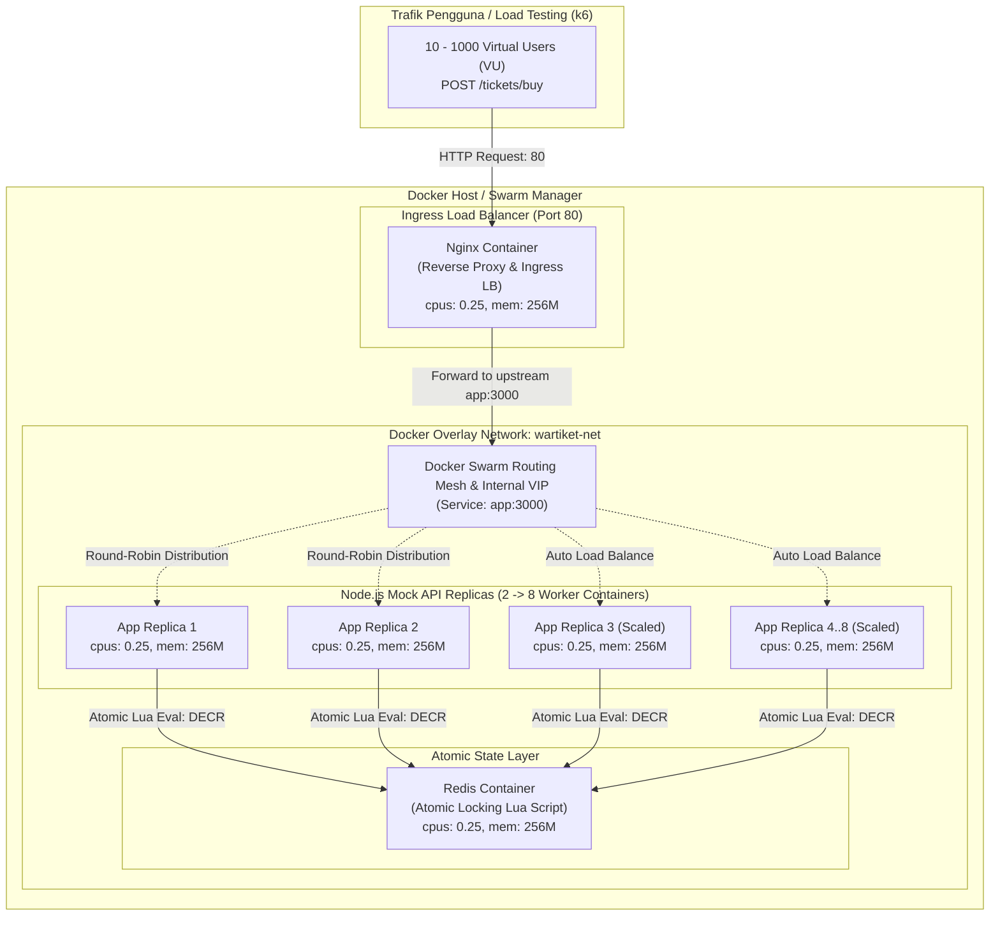

# Auto-Scaling & Load Balancing Sistem War Tiket Menggunakan Docker Swarm

> **Tugas Besar Mata Kuliah Cloud Computing (3 SKS)**  
> **Studi Kasus:** Sistem War Tiket Konser Musik  
> **Kelompok:** 1  

---

## 1. Ringkasan Proyek

Sistem **War Tiket** menghadapi karakteristik beban komputasi yang sangat ekstrem: lonjakan ribuan hingga jutaan *request* secara simultan dalam hitungan detik (*flash crowd traffic*). Masalah kritis yang sering terjadi pada skenario ini meliputi:
1. **Server Crash / Out of Memory (OOM)** akibat ketidakmampuan menangani lonjakan transaksi bersamaan.
2. **Race Condition / Overselling**: Tiket terjual melebihi kuota stok yang tersedia karena proses pengecekan dan pengurangan stok tidak berlangsung secara atomik.
3. **Single Point of Failure (SPOF)**: Jika satu server mati, seluruh transaksi terhenti.

Untuk mengatasi permasalahan tersebut, proyek ini mengimplementasikan:
- **Docker Swarm Ingress & Overlay Network**: Mengorkestrasi klaster container dengan perutean beban internal (*Routing Mesh*).
- **Nginx Reverse Proxy & Load Balancer**: Gerbang masuk tunggal (Port 80) yang mendistribusikan trafik masuk ke seluruh replika worker backend.
- **Node.js Mock API (Scalable Workers)**: Service pemrosesan *checkout* tiket dengan penundaan buatan (*artificial delay*) 50–100ms dan skalabilitas dinamis dari **2 hingga 8 replika**.
- **Redis In-Memory Atomic Locking**: Menjamin operasi pengecekan dan pengurangan stok berlangsung atomik via Redis Lua Scripting sehingga *overselling* bernilai 0% bahkan di bawah 1000 VU.
- **Resource Limits**: Setiap container dibatasi secara ketat pada `cpus: '0.25'` dan `memory: 256M`.

---

## 2. Diagram Arsitektur Sistem



---

## 3. Skema Jaringan Docker

Sistem menggunakan Docker Overlay Network berkonfigurasi `attachable: true`:

| Parameter Jaringan | Spesifikasi | Keterangan |
|---|---|---|
| **Nama Jaringan** | `wartiket-net` | Jaringan terisolasi antar container |
| **Driver Jaringan** | `overlay` | Mendukung multi-host routing & Docker Swarm ingress |
| **Port Publik** | `80:80` | Port host yang diekspos oleh container Nginx |
| **Internal Routing** | `app:3000` & `redis:6379` | Layanan backend dan redis tidak diekspos ke publik host |
| **Service Discovery** | Docker Internal DNS + IPVS | Resolusi otomatis nama `app` ke Virtual IP (VIP) Swarm |

---

## 4. Spesifikasi Komponen & Resource Limits

Sesuai ketentuan teknis standar (3 SKS), seluruh container memiliki batasan ketat:
```yaml
resources:
  limits:
    cpus: '0.25'      # Maksimal 25% dari 1 core CPU
    memory: 256M      # Maksimal RAM 256 MB
```

### Rincian Komponen:
1. **Nginx (`wartiket-nginx`)**:
   - Berfungsi sebagai reverse proxy dan buffer koneksi client.
   - Dikonfigurasi dengan `worker_connections 10240` dan HTTP/1.1 `keepalive 64` agar tidak kehabisan *file descriptor* saat diuji 1000 VU.
2. **Node.js Mock API (`wartiket-app`)**:
   - Menangani endpoint `/tickets/buy`, `/tickets`, `/tickets/reset`, dan `/health`.
   - Menginjeksikan penundaan buatan (*artificial delay*) 50–100ms pada setiap transaksi checkout.
   - Memberikan metadata respon nama hostname (`os.hostname()`) untuk membuktikan beban tersebar merata antar replika.
3. **Redis (`wartiket-redis`)**:
   - Menyimpan stok awal tiket (default: 1000 tiket).
   - Menjalankan **Lua Script** berikut:
     ```lua
     local current = tonumber(redis.call('GET', KEYS[1]) or '0')
     if current > 0 then
       redis.call('DECR', KEYS[1])
       return current - 1
     else
       return -1
     end
     ```
   - Operasi ini dieksekusi secara atomic dalam single-thread Redis, meniadakan *race condition* secara mutlak.

---

## 5. Panduan Menjalankan Sistem (Langkah-demi-Langkah)

### A. Inisialisasi Docker Swarm
Buka PowerShell / Terminal:
```bash
# Inisialisasi Docker Swarm (jika belum aktif)
docker swarm init
```

### B. Build Docker Image
Jalankan proses build image backend dan load balancer:
```bash
# Build image Node.js App
docker build -t wartiket-app:latest ./app

# Build image Nginx
docker build -t wartiket-nginx:latest ./nginx
```

### C. Deploy Stack ke Docker Swarm
Deploy seluruh arsitektur menggunakan Docker Compose:
```bash
# Deploy stack dengan nama 'wartiket'
docker stack deploy -c docker-compose.yml wartiket
```

Periksa status seluruh service dan task:
```bash
# Lihat daftar service aktif
docker stack services wartiket

# Lihat container yang sedang berjalan
docker stack ps wartiket
```

---

## 6. Skenario Pengujian & Live Demo

### Skenario 1: Sanity Check & Distribusi Load Balancing
Uji dengan 20 request simultan menggunakan skrip Node.js:
```bash
node test-quick.js
```
*Output akan menampilkan tabel 20 transaksi yang tersebar di container yang berbeda (ditandai dengan `ServedBy` yang berganti-ganti).*

### Skenario 2: Dynamic Auto-Scaling (Skalasi 2 $\rightarrow$ 8 Replika)
Saat lonjakan trafik war tiket terjadi, scale backend worker dari 2 menjadi 8 replika:
```bash
docker service scale wartiket_app=8
```
Verifikasi bahwa 8 replika kini aktif dalam hitungan detik:
```bash
docker service ps wartiket_app
```

Untuk mengembalikan (*scale down*):
```bash
docker service scale wartiket_app=2
```

### Skenario 3: Load Testing 1000 VU (k6)
Jalankan uji beban 3 menit bertahap (10 $\rightarrow$ 100 $\rightarrow$ 500 $\rightarrow$ 1000 VU) sesuai SLA (Response Time $< 200\text{ms}$, Error $< 1\%$):

**Jika k6 terinstal di host:**
```bash
k6 run load-test/load-test.js
```

**Atau jalankan k6 via Docker Container (tanpa instalasi lokal):**
```bash
docker run --rm -i -v "${PWD}/load-test:/load-test" --network host grafana/k6 run /load-test/load-test.js
```

### Skenario 4: Disaster Recovery (DR) & Failover Execution
Saat pengujian beban 1000 VU sedang berjalan:
1. Buka terminal baru dan matikan paksa 2 container worker backend:
   ```bash
   # Dapatkan ID container app
   docker ps --filter "name=wartiket_app" --format "{{.ID}}"
   
   # Matikan 2 container secara paksa
   docker rm -f <ID_CONTAINER_1> <ID_CONTAINER_2>
   ```
2. **Hasil Observasi**:
   - Docker Swarm secara otomatis mendeteksi matinya container dan langsung menjadwalkan ulang replika baru.
   - Nginx bersama Swarm Routing Mesh mengalihkan trafik ke replika yang masih sehat (*self-healing failover*).
   - Pengujian k6 tidak mengalami kegagalan transaksi (*zero downtime / zero transaction drop*).

---

## 7. Struktur Repositori

```text
├── app/
│   ├── Dockerfile             # Konfigurasi container Node.js Mock API
│   ├── package.json           # Dependencies Express & ioredis
│   ├── server.js              # Source code API, latency generator & Redis Lua script
│   ├── test.js                # Unit test self-check logika atomic decrement
│   └── .dockerignore          # Mengabaikan file dev / node_modules
├── nginx/
│   ├── Dockerfile             # Konfigurasi container Nginx
│   └── nginx.conf             # Konfigurasi reverse proxy, keepalive & timeouts
├── load-test/
│   └── load-test.js           # Skrip uji beban k6 (10-1000 VU, 3 menit, SLA check)
├── docker-compose.yml         # Spesifikasi Docker Swarm stack & resource limits (CPU 0.25, RAM 256M)
├── test-quick.js              # Skrip pengujian cepat verifikasi distribusi load balancing
├── PRESENTASI.md              # Panduan presentasi 7 menit, script live demo & Q&A
└── README.md                  # Dokumentasi resmi proyek
```

---

## 8. Pemenuhan Target Luaran Mingguan

- [x] **Pertemuan 1: Planning & Architecture Design**
  - Diagram arsitektur sistem (Mermaid).
  - Skema jaringan internal Docker (`overlay` network `wartiket-net`).
  - Spesifikasi awal `docker-compose.yml` dengan batasan CPU `0.25` dan RAM `256M`.
  - Repositori Git kelompok rapi dan terstruktur.
- [x] **Pertemuan 2: Environment Setup & Core Deployment**
  - Seluruh container (Nginx, App, Redis) terkonfigurasi dan dapat berjalan *up & running*.
  - Resource limit diterapkan pada berkas compose.
- [x] **Pertemuan 3 & 4 (Siap Pakai)**: Skrip k6 load testing dan skenario Disaster Recovery sudah siap diuji.
