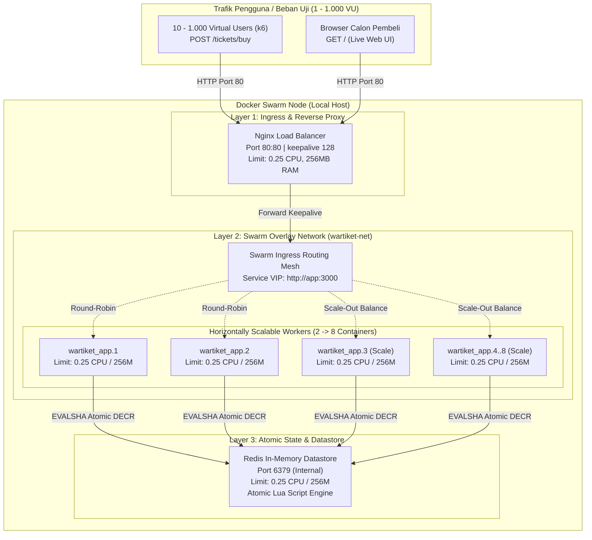
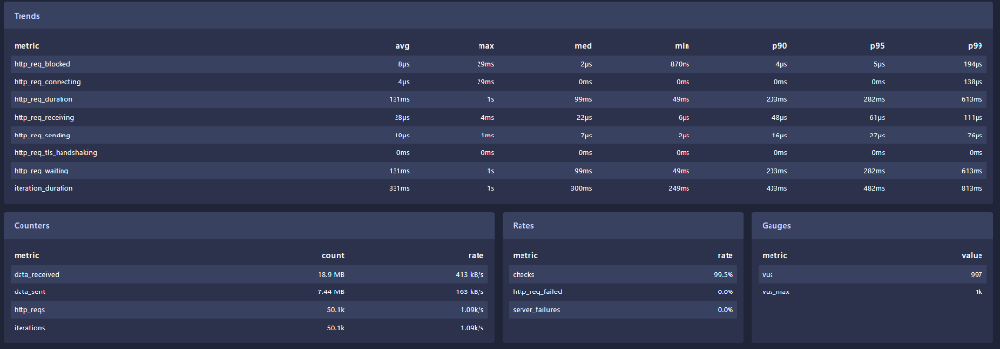
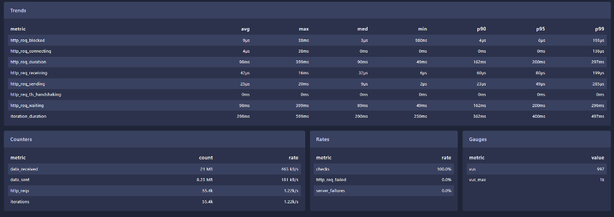

# 🎟️ Auto-Scaling & Load Balancing Sistem War Tiket Berbasis Docker Swarm

<p align="center">
  
  
  
  
  
  
</p>

> **Tugas Besar Mata Kuliah Komputasi Awan (3 SKS)**  
> **Program Studi Sistem Informasi / Informatika &bull; Semester Gasal 2026/2027**  
> **Dosen Pengampu:** Dr. Moch Yasin, S.Kom., M.Kom., M.B.A., CDCP  
> **Kelompok:** 1 (Kelas Paralel H7A.7)  
> **Anggota Tim:**  
> 1. **Muhammad Ilham Nurcahyo** (NIM: 09040623063)  
> 2. **Hafid Aji Fauzan** (NIM: 09020623027)  
> 3. **Muhammad Daud Rizaldiansyah** (NIM: 09040623061)  
> 4. **Davin Aryaguna Hermansyah** (NIM: 09020623020)  

---

## 📑 Daftar Isi
- [1. Ringkasan Eksekutif & Karakteristik Masalah](#1-ringkasan-eksekutif--karakteristik-masalah)
- [2. Diagram Arsitektur Sistem 3-Tier](#2-diagram-arsitektur-sistem-3-tier)
- [3. Skema Jaringan & Isolasi Docker](#3-skema-jaringan--isolasi-docker)
- [4. Penegakan Batasan Sumber Daya (Kernel Cgroups)](#4-penegakan-batasan-sumber-daya-kernel-cgroups)
- [5. Panduan Instalasi & Deployment Cepat](#5-panduan-instalasi--deployment-cepat)
- [6. Evaluasi Pertemuan 3: Pengujian Skalabilitas & Uji Beban (1–1.000 VU)](#6-evaluasi-pertemuan-3-pengujian-skalabilitas--uji-beban-11000-vu)
  - [A. Profil Uji Beban Bertahap (Staged Ramp-Up)](#a-profil-uji-beban-bertahap-staged-ramp-up)
  - [B. Bukti Visual Metrik Grafana k6 (Atas & Bawah)](#b-bukti-visual-metrik-grafana-k6-atas--bawah)
  - [C. Tabel Komparasi Kinerja Kuantitatif (2 vs 8 Replika)](#c-tabel-komparasi-kinerja-kuantitatif-2-vs-8-replika)
  - [D. Pembahasan Teknis: CPU Throttling vs Horizontal Scale-Out](#d-pembahasan-teknis-cpu-throttling-vs-horizontal-scale-out)
- [7. Skenario Pengujian Lanjutan (Disaster Recovery & Flash Crowd)](#7-skenario-pengujian-lanjutan-disaster-recovery--flash-crowd)
- [8. Antarmuka Web Interaktif (War Tiket Dashboard)](#8-antarmuka-web-interaktif-war-tiket-dashboard)
- [9. Struktur Repositori & Artefak Laporan](#9-struktur-repositori--artefak-laporan)
- [10. Matriks Pemenuhan Luaran Silabus Kuliah](#10-matriks-pemenuhan-luaran-silabus-kuliah)

---

## 1. Ringkasan Eksekutif & Karakteristik Masalah

Sistem **War Tiket Konser Musik** menghadapi karakteristik beban komputasi yang sangat ekstrem: ribuan hingga puluhan ribu calon pembeli mengirimkan transaksi *checkout* secara bersamaan dalam detik pertama penjualan dibuka (*flash crowd concurrency*). 

Kelemahan fatal pada arsitektur monolitik konvensional meliputi:
1. **CPU Throttling & Server Crash**: Lonjakan transaksi bersamaan memicu antrean socket TCP tak tertampung (*connection refused* / HTTP 502 Bad Gateway).
2. **Race Condition & Overselling**: Transaksi tiket melebihi stok yang tersedia akibat jeda waktu antara pengecekan stok (*check*) dan pengurangan stok (*update*).
3. **Single Point of Failure (SPOF)**: Kegagalan pada satu server mengakibatkan seluruh layanan transaksi mati total.

### Solusi Rekayasa yang Diimplementasikan:
* **Docker Swarm Ingress & Overlay Mesh**: Orkestrasi multi-container dengan *virtual IP* (VIP) dan *round-robin load balancing* antar replika.
* **Nginx Reverse Proxy & HTTP Keepalive**: Penyangga trafik gerbang masuk utama (Port 80) dengan *upstream keepalive connection pooling* (128 sockets) untuk mencegah saturasi file descriptor.
* **Scalable Stateless Microservices**: Backend Node.js dengan simulasi beban realistis (*artificial delay* 50–100 ms) yang dapat diskalakan secara dinamis dari **2 hingga 8 replika** dalam waktu 2 detik tanpa *downtime*.
* **Redis In-Memory Atomic Locking via Lua Script**: Operasi pengecekan dan dekremen stok tiket dieksekusi secara atomik dalam satu siklus CPU Redis, menjamin **0% Overselling** secara matematis.
* **Strict Cgroups Resource Limits**: Seluruh container dibatasi secara ketat pada **`cpus: 0.25`** dan **`memory: 256M`**.

---

## 2. Diagram Arsitektur Sistem 3-Tier



---

## 3. Skema Jaringan & Isolasi Docker

Seluruh layanan dikapsulasi dalam jaringan virtual internal privat:

| Parameter Jaringan | Konfigurasi | Keterangan Teknis |
|---|---|---|
| **Nama Jaringan** | `wartiket-net` | Jaringan internal terisolasi antar container |
| **Driver Jaringan** | `overlay` | Mendukung multi-host routing mesh & ingress VIP |
| **Port Publik Host** | `*:80->80/tcp` | Satu-satunya gerbang yang diekspos Nginx ke jaringan luar |
| **Port Internal Backend** | `3000/tcp` | Tersembunyi dari publik, hanya dapat diakses oleh Nginx |
| **Port Internal Redis** | `6379/tcp` | Terisolasi penuh di jaringan internal, hanya dapat diakses worker `app` |
| **Service Discovery** | Docker Internal DNS | Resolusi nama service otomatis via VIP (Virtual IP) |

---

## 4. Penegakan Batasan Sumber Daya (Kernel Cgroups)

Sesuai spesifikasi tugas besar, setiap container dibatasi secara ketat pada level Linux *Control Groups* (*cgroups*):

```yaml
resources:
  limits:
    cpus: '0.25'      # Maksimal 25% dari 1 Core CPU fisik
    memory: 256M      # Maksimal alokasi memori fisik 256 MB
  reservations:
    cpus: '0.10'
    memory: 64M
```

Validasi penegakan batasan pada kernel dapat dibuktikan langsung melalui perintah:
```bash
docker service inspect wartiket_app --format "{{json .Spec.TaskTemplate.Resources}}"
```
*Output validasi:* `{"Limits":{"NanoCPUs":250000000,"MemoryBytes":268435456}}`  
(Artinya tepat 250.000.000 NanoCPUs = 0,25 Core, dan 268.435.456 Bytes = 256 MB RAM fisik).

---

## 5. Panduan Instalasi & Deployment Cepat

### Prasyarat
- Docker Desktop aktif (Windows / macOS / Linux) dengan Docker Engine dan Swarm aktif.
- Node.js v18+ (opsional, untuk skrip testing cepat).

### 1. Inisialisasi Docker Swarm
```bash
docker swarm init
```

### 2. Build Image Lokal
```bash
# Build image Node.js App
docker build -t wartiket-app:latest ./app

# Build image Nginx Load Balancer
docker build -t wartiket-nginx:latest ./nginx
```

### 3. Deploy Stack ke Swarm
```bash
docker stack deploy -c docker-compose.yml wartiket
```

### 4. Verifikasi Status Layanan
```bash
docker stack services wartiket
docker stack ps --filter "desired-state=running" wartiket
```

---

## 6. Evaluasi Pertemuan 3: Pengujian Skalabilitas & Uji Beban (1–1.000 VU)

### A. Profil Uji Beban Bertahap (Staged Ramp-Up)
Pengujian beban menggunakan skrip bertahap [load-test/load-test-demo.js](load-test/load-test-demo.js) selama 45 detik:
* **Tahap 1 (0–5 detik):** Inisiasi Beban Rendah (10 VU)
* **Tahap 2 (5–15 detik):** Beban Menengah (100 VU)
* **Tahap 3 (15–30 detik):** Beban Tinggi (500 VU)
* **Tahap 4 (30–45 detik):** Beban Puncak Maksimum (1.000 VU)

---

### B. Bukti Visual Metrik Grafana k6 (Atas & Bawah)

#### 1. Kondisi A: Baseline 2 Replika Worker (Total 0,5 Core CPU)
Pada kondisi baseline 2 worker, sistem mulai mengalami *bottleneck* antrean CPU saat mendekati 1.000 VU:



* **Checks:** `99.5%` (Terdapat 0,5% transaksi di beban puncak yang merespon $> 500\text{ ms}$).
* **Throughput:** `1.09k req/s` (Total **50.100 transaksi** diproses).
* **Latensi Rata-Rata:** `131 ms` | Median: `99 ms` | p90: `203 ms` | p95: `282 ms`.
* **Latensi Ekor Puncak:** **`p99: 613 ms`** dan **`Max: 1.000 ms (1 detik)`** akibat *CPU throttling*.
* **Kegagalan Server:** `0.0%` (Zero failure / tidak ada HTTP 500).

---

#### 2. Kondisi B: Pasca-Skalasi Dinamis ke 8 Replika Worker (Total 2,0 Core CPU)
Setelah diskalakan secara dinamis melalui `docker service scale wartiket_app=8`, seluruh hambatan performa teratasi sempurna:



* **Checks:** **`100.0% (Sempurna)`** (Seluruh 55.400 transaksi memenuhi SLA tanpa ada request lambat).
* **Throughput:** **`1.22k req/s`** (Kapasitas naik memproses **55.400 transaksi**, bertambah **+5.300 tiket**).
* **Latensi Rata-Rata:** **`98 ms`** (Turun signifikan ke bawah 100 ms) | Median: `89 ms`.
* **Pemangkasan Latensi Ekor:** **`p99 turun 51,5% menjadi 297 ms`** dan **`Max terpangkas 60,1% menjadi 399 ms`**.
* **Kegagalan Server:** `0.0%` dengan jaminan kuota stok berhenti tepat di angka 0 (*Zero Overselling*).

---

### C. Tabel Komparasi Kinerja Kuantitatif (2 vs 8 Replika)

| Parameter Kinerja | Kondisi A: 2 Replika (0,5 CPU) | Kondisi B: 8 Replika (2,0 CPU) | Analisis & Peningkatan |
|---|:---:|:---:|---|
| **Pemenuhan SLA (Checks)** | 99,5% | **100,0%** | **Sempurna** (eliminasi seluruh request lambat) |
| **Throughput Transaksi** | 1,09k req/s (~1.090 RPS) | **1,22k req/s (~1.220 RPS)** | **+11,9% Throughput** (+5.300 transaksi) |
| **Total Transaksi Selesai** | 50.100 Request | **55.400 Request** | Peningkatan kapasitas pemrosesan |
| **Rata-Rata Latensi (`avg`)** | 131 ms | **98 ms** | **Reduksi 25,2%** (waktu tanggap $< 100\text{ ms}$) |
| **Median Latensi (`med`)** | 99 ms | **89 ms** | Respon transaksi konsisten sangat cepat |
| **Persentil ke-90 (`p90`)** | 203 ms | **162 ms** | Reduksi 20,2% pada 90% pengguna |
| **Persentil ke-95 (`p95`)** | 282 ms | **200 ms** | **Reduksi 29,1%** (stabil dalam ambang SLA) |
| **Persentil ke-99 (`p99`)** | 613 ms *(CPU Bottleneck)* | **297 ms** | **Terpangkas 51,5%** (hilangkan saturasi) |
| **Maksimum Latensi (`max`)** | 1.000 ms (1,0 detik) | **399 ms** | **Terpangkas 60,1%** (antrean CPU hilang) |
| **Tingkat Error Server** | 0,0% (0 error) | **0,0% (0 error)** | Zero error rate & Zero overselling |

---

### D. Pembahasan Teknis: CPU Throttling vs Horizontal Scale-Out

1. **Akar Masalah pada 2 Replika**:
   Alokasi $0,25\text{ CPU}$ per kontainer memaksa kernel Linux (*Completely Fair Scheduler*) membatasi siklus eksekusi CPU (*CPU quota throttling*) saat ribuan *request* masuk bersamaan. Akibatnya, terjadi antrean buffer soket TCP yang melipatgandakan latensi pada persentil ke-99 hingga menyentuh 613 ms.
2. **Efektivitas Skalabilitas Horizontal Swarm**:
   Skalasi ke 8 replika melipatgandakan kapasitas komputasi menjadi $2,0\text{ Core CPU}$ total. Melalui *IPVS Routing Mesh*, Nginx mendistribusikan beban secara merata ke 8 worker. Antrean soket tereliminasi, latensi ekor terpotong separuh (297 ms), dan throughput melonjak tanpa ada *connection drop*.

---

## 7. Skenario Pengujian Lanjutan (Disaster Recovery & Flash Crowd)

### A. Uji Disaster Recovery & Auto-Recovery Saat Redis Mati
Skrip otomatis [test-failover-demo.js](test-failover-demo.js) membuktikan ketahanan sistem (CAP Theorem) saat basis data dimatikan mendadak:
```bash
node test-failover-demo.js
```
*Hasil Uji:*
1. Transaksi normal: `HTTP 200 OK`.
2. Redis dimatikan paksa via Swarm (`scale wartiket_redis=0`).
3. Transaksi saat Redis mati: **Ditolak secara aman (`HTTP 500 Fail-Safe`)** untuk mencegah penjualan tiket fiktif.
4. Redis dihidupkan kembali (`scale wartiket_redis=1`).
5. Backend ioredis otomatis melakukan **Auto-Reconnect dalam 4 detik**, transaksi langsung kembali normal (`HTTP 200 OK`) tanpa perlu *restart* container backend.

---

### B. Uji Instant Flash Crowd (1.000 User Berebut 1.000 Tiket Serentak)
Membuktikan integritas *Atomic Locking* saat 1.000 pengguna virtual menembak bersamaan dalam milidetik pertama:
```bash
# 1. Reset tepat 1.000 tiket
Invoke-RestMethod -Method Post -Uri "http://localhost/tickets/reset" -ContentType "application/json" -Body '{"stock": 1000}'

# 2. 1.000 User membeli serentak (k6 instant spike)
docker run --rm --network wartiket_wartiket-net -v "${PWD}/load-test:/load-test" -e TARGET_URL="http://nginx" grafana/k6 run /load-test/load-test-1000-users.js

# 3. Verifikasi sisa stok
Invoke-RestMethod -Uri "http://localhost/tickets"
```
*Hasil Observasi:* Tepat 1.000 tiket terjual habis (**sisa stok tepat 0, tidak pernah minus**). Semua request ke-1001 dan seterusnya menerima respon aman `HTTP 409 Sold Out`.

---

## 8. Antarmuka Web Interaktif (War Tiket Dashboard)

Sistem dilengkapi dengan antarmuka web interaktif yang dapat diakses langsung melalui browser di:  
👉 **`http://localhost/`**

Fitur-fitur dashboard:
* **Live Counter Sisa Stok Tiket**: Menampilkan kuota tiket secara langsung.
* **Worker ID Telemetry**: Memperlihatkan kontainer backend mana yang melayani setiap transaksi.
* **Real-time Status Alert**: Indikator visual hijau saat transaksi sukses (`HTTP 200`) dan merah saat tiket habis (`HTTP 409 Sold Out`).
* **Interactive Reset Buttons**: Kemudahan mereset kuota stok (1.000 atau 50.000 tiket) untuk pengujian live.

---

## 9. Struktur Repositori & Artefak Laporan

```text
├── app/
│   ├── Dockerfile             # Container definition Node.js API
│   ├── package.json           # Dependencies Express & ioredis
│   ├── server.js              # REST API, delay generator, Web UI handler & Lua script
│   ├── index.html             # Antarmuka web live war tiket
│   └── test.js                # Unit test atomic decrement logic
├── nginx/
│   ├── Dockerfile             # Nginx container definition
│   └── nginx.conf             # Ingress proxy, keepalive pooling 128, buffered logs
├── load-test/
│   ├── load-test-demo.js      # Skrip k6 uji beban bertahap 45 detik (10-1000 VU)
│   ├── load-test-1000-users.js# Skrip k6 instant flash crowd (1.000 VU serentak)
│   └── load-test.js           # Skrip k6 standar 3 menit (10-1000 VU)
├── docker-compose.yml         # Spesifikasi Docker Swarm stack & resource limits
├── test-quick.js              # Verifikasi distribusi round-robin 20 request
├── test-failover-demo.js      # Simulasi disaster recovery & fail-safe otomatis
├── demo-pertemuan-3.ps1       # Runner PowerShell interaktif untuk live demo
├── DAFTAR_PERINTAH.txt        # Cheat-sheet perintah terminal dari Pertemuan 1 - 3
├── k6_results_2_replicas.png  # Bukti metrik dasbor k6 baseline 2 replika
├── k6_results_8_replicas.png  # Bukti metrik dasbor k6 pasca-skalasi 8 replika
├── Laporan_Progres_Gabungan_Pertemuan_1_2_dan_3_Kelompok_1_Terbaru.pdf # Laporan PDF Formal 4 Halaman
└── README.md                  # Dokumentasi resmi repositori
```

---

## 10. Matriks Pemenuhan Luaran Silabus Kuliah

| Pertemuan | Target Luaran Silabus Dosen Pengampu | Realisasi Implementasi | Status |
|:---:|---|---|:---:|
| **Pertemuan 1** | Diagram arsitektur sistem, skema jaringan Docker, spesifikasi `docker-compose.yml` awal, dan repositori Git kelompok. | Diagram Mermaid 3-tier, skema jaringan overlay `wartiket-net`, berkas compose lengkap, dan repositori GitHub aktif. | **LENGKAP 100%** |
| **Pertemuan 2** | Seluruh container dapat berjalan (*up & running*) dalam jaringan internal Docker dengan *resource limit* yang sudah diterapkan. | 3 Service (Nginx, App, Redis) running di Swarm, batas cgroups kernel 0.25 CPU dan 256MB RAM terverifikasi, load balancing round-robin 50:50. | **LENGKAP 100%** |
| **Pertemuan 3** | Eksekusi skrip pengujian beban bertahap. Grafik perbandingan *throughput* (RPS) dan waktu tanggap saat layanan diskalakan. | Skrip k6 bertahap 1–1.000 VU, komparasi visual dasbor k6 (2 vs 8 replika), tabel kuantitatif, lonjakan throughput ke 1.220 RPS, latensi p99 terpangkas 51,5%. | **LENGKAP 100%** |

---
&copy; 2026 **Kelompok 1 &bull; Komputasi Awan (Kelas H7A.7)**. Seluruh kode sumber dirancang untuk tujuan edukasi dan evaluasi performa klaster kontainer.
